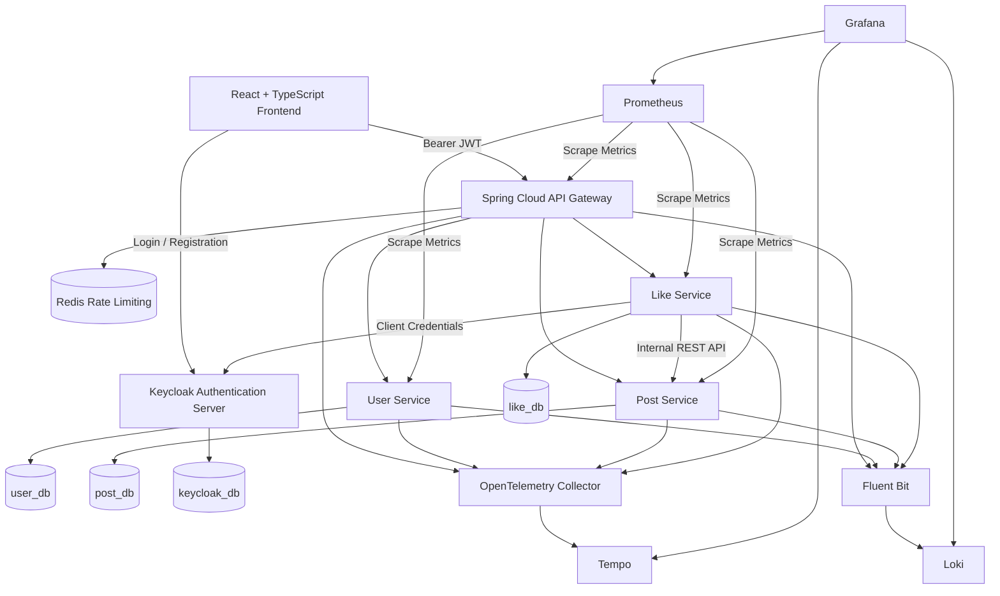

# Mini Instagram — Spring Boot Microservices

A full-stack, Instagram-inspired social media application built using **Java 21, Spring Boot, Spring Cloud Gateway, React, TypeScript, PostgreSQL, Redis, Docker, and Keycloak**.

This project demonstrates how to design, develop, secure, deploy, monitor, and test a microservices-based application.

The focus is on real-world backend engineering practices, including:

- Microservices architecture
- REST API design
- OAuth 2.0 and OpenID Connect authentication
- JWT-based authorization
- API Gateway routing
- Redis distributed rate limiting
- Database-per-service architecture
- Inter-service REST communication
- Docker containerization
- Centralized logging
- Distributed tracing
- Application metrics and monitoring
- API and performance testing

**Project status:** Working local development implementation. The backend services, frontend, authentication, post creation, likes, and API Gateway rate limiting have been tested locally. This is a learning/reference project, not a production-certified deployment.

---

## 1. Project Overview

Mini Instagram is a simplified social media application inspired by Instagram.

Users can register, log in, manage their profiles, create posts, browse posts, and like or unlike posts.

Instead of building the backend as a single application, the project uses multiple independently deployable Spring Boot services.

### Main Features

**Authentication and User Management**

- User registration through Keycloak
- Secure login and logout
- OAuth 2.0 Authorization Code Flow with PKCE
- JWT-based authentication
- View authenticated user profile
- Update authenticated user profile

**Post Management**

- Create posts
- View posts
- View individual post details
- Update owned posts
- Delete owned posts
- Paginated post listing

**Like Management**

- Like a post
- Unlike a post
- View a post's total likes
- Prevent duplicate likes
- Verify that a post exists before accepting a like

**Infrastructure and Security**

- Centralized API Gateway
- JWT validation
- Service-level authorization
- Redis-based rate limiting
- PostgreSQL databases
- Flyway database migrations
- Docker Compose orchestration
- Health-check endpoints
- Centralized JSON logging
- Distributed tracing
- Metrics monitoring

---

## 2. Technology Stack

| Category | Technology |
|---|---|
| Programming Language | Java 21 |
| Backend Framework | Spring Boot 4.1.2 |
| Microservices | Spring Boot |
| Spring Cloud | Spring Cloud 2025.1.4 |
| API Gateway | Spring Cloud Gateway |
| Security | Spring Security |
| Authentication | Keycloak 26.4.2 |
| Authorization | OAuth 2.0, OpenID Connect, JWT |
| Database | PostgreSQL 17.6 |
| Database Access | Spring Data JPA |
| Database Migration | Flyway |
| Rate Limiting | Redis |
| Frontend | React 18 |
| Frontend Language | TypeScript |
| Frontend Build Tool | Vite |
| Containerization | Docker |
| Orchestration | Docker Compose |
| Application Logs | SLF4J, Logback, AOP |
| Structured Logging | JSON |
| Log Collection | Fluent Bit |
| Log Storage | Loki |
| Metrics | Spring Boot Actuator, Micrometer |
| Metrics Collection | Prometheus |
| Distributed Tracing | OpenTelemetry, Tempo |
| Visualization | Grafana |
| Build Tool | Maven |
| Source Control | Git |
| Repository Hosting | GitHub |

---

## 3. System Architecture

The application consists of four Spring Boot applications:

1. API Gateway
2. User Service
3. Post Service
4. Like Service

The React frontend communicates with backend services through the API Gateway.

Keycloak manages user authentication and token generation.

Each business service owns its database.

### Architecture Diagram



### Request Flow

1. A user opens the React application.
2. The user registers or logs in through Keycloak.
3. Keycloak authenticates the user and issues tokens.
4. The frontend sends API requests with a bearer access token.
5. Spring Cloud Gateway processes incoming requests.
6. Redis-based rate limiting determines whether requests are allowed.
7. The gateway forwards allowed requests to the appropriate microservice.
8. Backend services validate tokens and enforce authorization rules.
9. Services interact with their respective PostgreSQL databases.
10. The response returns to the frontend through the gateway.

---

## 4. Microservices Description

### 4.1 API Gateway

The API Gateway is the single entry point for frontend-to-backend API communication.

**Responsibilities:**

- Route requests to backend services
- Apply Redis-based request rate limiting
- Validate JWTs where configured
- Handle gateway-level security rules
- Expose gateway health and monitoring endpoints
- Produce metrics, traces, and structured logs

**Local URL:**

http://localhost:8080

**Example:**

```http
GET http://localhost:8080/api/v1/posts?page=0&size=5
```

The frontend does not need to call each business service directly.

### 4.2 User Service

The User Service manages application-level user profiles.

**Responsibilities:**

- Get authenticated user details
- Update authenticated user details
- Validate access tokens
- Store application-specific user information

**Database:** `user_db`

**Endpoints:**

```http
GET /api/v1/users/me
PATCH /api/v1/users/me
```

Keycloak owns authentication credentials, while the User Service manages application profile data.

### 4.3 Post Service

The Post Service manages social media posts.

**Responsibilities:**

- Create posts
- List posts
- Retrieve posts by ID
- Update posts
- Soft-delete posts
- Check post ownership
- Validate whether a post exists for internal service calls

**Database:** `post_db`

**Endpoints:**

```http
POST /api/v1/posts
GET /api/v1/posts
GET /api/v1/posts/{postId}
PATCH /api/v1/posts/{postId}
DELETE /api/v1/posts/{postId}
```

Only the post owner can update or delete their posts.

**Internal endpoint:**

```http
GET /internal/posts/{postId}/exists
```

This internal endpoint is used by the Like Service and is not exposed through the public API Gateway.

### 4.4 Like Service

The Like Service manages likes on posts.

**Responsibilities:**

- Like a post
- Unlike a post
- Count likes
- Prevent duplicate likes
- Verify that the target post exists
- Communicate with the Post Service using service authentication

**Database:** `like_db`

**Endpoints:**

```http
PUT /api/v1/posts/{postId}/likes/me
DELETE /api/v1/posts/{postId}/likes/me
GET /api/v1/posts/{postId}/likes/count
```

Likes use an idempotent design.

For example, liking the same post more than once does not create duplicate likes.

The implementation uses PostgreSQL conflict handling to enforce this behavior.

---

## 5. Database Architecture

The application follows the **Database per Service** design pattern.

Each business microservice owns its database and does not directly access another service's tables.

| Database | Owner | Purpose |
|---|---|---|
| `user_db` | User Service | User profile information |
| `post_db` | Post Service | Post information |
| `like_db` | Like Service | Like relationships |
| `keycloak_db` | Keycloak | Identity and authentication data |

In the local Docker environment, these databases can share the same PostgreSQL server while remaining logically separated.

### Why Database per Service?

- Clear ownership of data
- Reduced coupling between microservices
- Independent schema changes
- Better service boundaries
- Easier future migration to separate database instances

### Database Migrations

Flyway manages database schema migrations for the business services.

Migration scripts are versioned alongside the application code.

### Post Deletion

Posts use soft deletion.

Deleted posts are excluded from public reads and cannot receive new likes.

Existing like records are not automatically removed by the current implementation. Cleanup and reconciliation are future improvements.

---

## 6. Authentication and Authorization

Authentication is managed using **Keycloak**.

### Authentication Flow

The frontend uses the OAuth 2.0 Authorization Code Flow with PKCE.

```text
User opens frontend
        |
        v
Click Login / Register
        |
        v
Redirect to Keycloak
        |
        v
User authenticates
        |
        v
Keycloak issues tokens
        |
        v
Frontend calls API Gateway
        |
        v
Gateway and services validate JWT
        |
        v
Service checks authorization
        |
        v
API response
```

### JWT Validation

The backend security design validates relevant JWT properties, including:

- Token signature
- Issuer
- Audience
- Expiration
- Required authentication information

Backend services also enforce resource-level authorization.

For example:

- Users can update their own profiles.
- Users can create posts while authenticated.
- Only a post's author can update or delete it.
- Likes belong to the authenticated user.

### Important Design Decision

The Spring Boot services do **not** implement their own username/password login API.

Keycloak manages:

- Registration
- Authentication
- Password management
- Token generation
- Identity information

### Service-to-Service Authentication

The Like Service communicates with the Post Service using the OAuth 2.0 Client Credentials flow.

The Like Service obtains a service-account token from Keycloak before calling the internal Post Service endpoint.

The internal Post Service endpoint verifies that the token belongs to the allowed service client and checks its audience.

This prevents ordinary frontend users from accessing the service-only endpoint.

---

## 7. REST API Documentation

The application exposes **10 public API operations**.

| No. | Method | Endpoint | Authentication | Description |
|---|---|---|---|---|
| 1 | GET | `/api/v1/users/me` | Required | Get current user profile |
| 2 | PATCH | `/api/v1/users/me` | Required | Update current user profile |
| 3 | POST | `/api/v1/posts` | Required | Create post |
| 4 | GET | `/api/v1/posts` | Public | List posts |
| 5 | GET | `/api/v1/posts/{postId}` | Public | Get post details |
| 6 | PATCH | `/api/v1/posts/{postId}` | Post owner | Update post |
| 7 | DELETE | `/api/v1/posts/{postId}` | Post owner | Delete post |
| 8 | PUT | `/api/v1/posts/{postId}/likes/me` | Required | Like post |
| 9 | DELETE | `/api/v1/posts/{postId}/likes/me` | Required | Unlike post |
| 10 | GET | `/api/v1/posts/{postId}/likes/count` | Public | Get like count |

### Example: Get Posts

**Request**

```http
GET http://localhost:8080/api/v1/posts?page=0&size=5
```

**PowerShell**

```powershell
curl.exe "http://localhost:8080/api/v1/posts?page=0&size=5"
```

This returns a paginated list of posts.

### Example: Check API Gateway Health

```http
GET http://localhost:8080/actuator/health
```

**PowerShell**

```powershell
curl.exe http://localhost:8080/actuator/health
```

Expected healthy response:

```json
{
  "groups": [
    "liveness",
    "readiness"
  ],
  "status": "UP"
}
```

### Example: Authenticated Request

```http
GET /api/v1/users/me
Authorization: Bearer <ACCESS_TOKEN>
```

The access token is obtained through the Keycloak login process.

Never commit access tokens or credentials to source control.

For detailed request bodies, responses, validation rules, and API contracts, see:

- `docs/API.md`
- `docs/openapi.yaml`

---

## 8. Redis Rate Limiting

The API Gateway uses Redis and Spring Cloud Gateway's Redis rate limiter.

The rate limiter is based on the **Token Bucket algorithm**.

### Why Rate Limiting?

Rate limiting helps protect APIs against:

- Excessive requests
- Accidental request floods
- Uncontrolled client traffic
- Resource exhaustion
- Basic application-layer abuse

### Token Bucket Algorithm

The token bucket has two important parameters:

**Replenish Rate**

The number of tokens added to the bucket each second.

**Burst Capacity**

The maximum number of tokens the bucket can hold.

Each request consumes a configured number of tokens.

When insufficient tokens are available, the gateway rejects the request.

### Example: GET Posts Rate Limit

| Setting | Value |
|---|---|
| Replenish Rate | 2 tokens/second |
| Burst Capacity | 20 tokens |
| Requested Tokens | 1 |
| Rejected Response | HTTP 429 Too Many Requests |
| Token Storage | Redis |

### How It Works

```text
Incoming API request
        |
        v
API Gateway
        |
        v
Resolve client identity
        |
        v
Check Redis token bucket
        |
        v
Are tokens available?
      /   \
    Yes    No
     |      |
     v      v
Allow     HTTP 429
request
     |
     v
Backend service
```

### Rate Limit Identity

Rate-limit keys are based on:

- Authenticated user's JWT subject, when available
- Client IP address for anonymous requests

Rate limits are configured per route rather than as one universal limit across all endpoints.

Redis uses atomic script execution to coordinate token consumption.

---

## 9. Redis Load Testing Results

Redis rate limiting was tested locally through the API Gateway using Windows PowerShell.

The goal was to verify that permitted requests return successfully while excessive requests receive HTTP 429 responses.

### Test 1: Sequential Requests

| Metric | Result |
|---|---|
| Total Requests | 60 |
| HTTP 200 | 26 |
| HTTP 429 | 34 |

**Observation:**

Some requests were allowed while the remaining requests were rate-limited, demonstrating the configured token bucket behavior over the test duration.

### Test 2: Concurrent Requests

A concurrent test was performed using 10 PowerShell workers.

| Metric | Result |
|---|---|
| Total Requests | 100 |
| Concurrent Workers | 10 |
| HTTP 200 Responses | 38 |
| HTTP 429 Responses | 62 |
| Test Duration | 10.16 seconds |
| Observed Throughput | 9.84 requests/second |
| Average Response Time | 24.11 ms |
| P95 Response Time | 52.1 ms |
| HTTP 5xx Responses | 0 |

### HTTP Response Distribution

```text
HTTP 200 : 38 requests (38%)
HTTP 429 : 62 requests (62%)
HTTP 5xx :  0 requests (0%)
```

### Interpretation

The results show that:

1. The API Gateway accepted requests within the available token budget.
2. Excess traffic was rejected with HTTP 429.
3. The application continued returning successful responses to permitted requests.
4. No HTTP 5xx responses occurred during the recorded concurrent test.
5. Redis was operational during testing.

**Important:** These results were recorded in a local development environment. The measured throughput includes PowerShell execution and scheduling overhead. It is not a benchmark of the maximum capacity of Redis or the Spring Boot services.

### Redis Verification

The following Redis diagnostics were also checked:

- Redis `PING` returned `PONG`.
- Redis was accepting commands.
- No rejected connections were observed.
- No cache evictions were observed.
- Memory usage was approximately 1.17 MB out of a configured 128 MB maximum at the time of inspection.

The recorded memory usage is only a point-in-time observation.

---

## 10. Project Folder Structure

```text
mini-instagram/
│
├── pom.xml
│
├── compose.yaml
├── compose.prod.yaml
├── Dockerfile.service
│
├── services/
│   ├── api-gateway/
│   ├── user-service/
│   ├── post-service/
│   └── like-service/
│
├── common/
│   └── common-core/
│
├── frontend/
│   ├── src/
│   ├── package.json
│   └── ...
│
├── infrastructure/
│   ├── keycloak/
│   ├── nginx/
│   └── ...
│
├── scripts/
│   ├── bootstrap.py
│   ├── verify_project.py
│   └── smoke-test.sh
│
├── docs/
│   ├── API.md
│   ├── SECURITY.md
│   ├── DEPLOYMENT.md
│   ├── TESTING.md
│   ├── LIMITATIONS.md
│   └── openapi.yaml
│
├── .github/
│   └── workflows/
│       └── ci.yaml
│
├── .gitignore
│
└── README.md
```

### Directory Responsibilities

| Directory | Purpose |
|---|---|
| `services/` | Spring Boot microservices |
| `common/common-core/` | Shared backend components |
| `frontend/` | React and TypeScript application |
| `infrastructure/` | Supporting infrastructure configurations |
| `scripts/` | Bootstrap, verification, and smoke-test scripts |
| `docs/` | API, security, testing, and deployment documentation |
| `.github/workflows/` | CI workflow configuration |

The `common-core` module contains reusable cross-cutting functionality such as error handling, logging, security helpers, and pagination.

---

## 11. Prerequisites

Install the following tools before running the project locally.

| Tool | Version / Requirement |
|---|---|
| Java | 21 |
| Docker | Docker Desktop or Docker Engine |
| Docker Compose | V2 |
| Node.js | 22 |
| npm | Compatible with Node.js 22 |
| Python | Python 3 |
| Git | Recent version |
| Maven | Required for local Maven builds outside Docker |

For Windows development, PowerShell can be used to run the setup commands.

Docker should have at least **8 GB of available memory**, with more recommended for the full infrastructure stack.

### Verify Installed Tools

Open PowerShell and run:

```powershell
java -version
docker --version
docker compose version
node --version
npm --version
python --version
git --version
```

If Maven is installed locally:

```powershell
mvn -version
```

---

## 12. Running the Project Locally on Windows

### Step 1: Clone the Repository

After publishing this project to GitHub, clone it using:

```powershell
git clone https://github.com/alok-commits/mini-instagram.git
```

Move into the project directory:

```powershell
cd mini-instagram
```

If you already have the project locally, simply open its existing folder.

### Step 2: Generate Development Configuration

The project includes a bootstrap script for generating development credentials and Keycloak realm configuration.

Run:

```powershell
python scripts/bootstrap.py
```

On systems where Python is invoked as `python3`:

```bash
python3 scripts/bootstrap.py
```

**Important:**

- Run bootstrap before the initial Keycloak startup.
- Keep generated credentials private.
- Do not commit `.env` to GitHub.
- Do not publish generated Keycloak configuration containing secrets.
- Do not rerun bootstrap against an existing environment without understanding how it affects credentials and stored data.

### Step 3: Validate Docker Compose Configuration

```powershell
docker compose config -q
```

This checks whether the Compose configuration can be parsed and resolved.

### Step 4: Start Backend Services

```powershell
docker compose up --build -d
```

This builds and starts the configured application and supporting infrastructure containers.

The first build may take longer because Maven dependencies and Docker images must be downloaded.

### Step 5: Check Container Status

```powershell
docker compose ps -a
```

Check that the application services are running and healthy.

The main backend applications are:

```text
api-gateway
user-service
post-service
like-service
```

### Step 6: View Backend Logs

```powershell
docker compose logs --tail=100 api-gateway
```

```powershell
docker compose logs --tail=100 user-service
```

```powershell
docker compose logs --tail=100 post-service
```

```powershell
docker compose logs --tail=100 like-service
```

To follow live logs:

```powershell
docker compose logs -f --tail=100 api-gateway
```

Use `Ctrl + C` to stop following logs. This does not stop the container.

### Step 7: Verify API Gateway

```powershell
curl.exe http://localhost:8080/actuator/health
```

Expected status:

```json
{
  "status": "UP"
}
```

The actual response may include health groups and additional fields.

### Step 8: Test the Posts API

```powershell
curl.exe "http://localhost:8080/api/v1/posts?page=0&size=5"
```

A successful response returns the paginated posts data.

If the database does not yet contain posts, the collection may be empty.

### Step 9: Start React Frontend

Open another PowerShell terminal.

From the project root:

```powershell
cd frontend
```

Install dependencies:

```powershell
npm install
```

Build the frontend:

```powershell
npm run build
```

Start the development server:

```powershell
npm run dev
```

### Step 10: Open the Application

Visit:

http://localhost:5173

The React frontend should load.

Use the application's login or registration option to authenticate through Keycloak.

---

## 13. Important Local URLs

| Application | Local URL |
|---|---|
| React Frontend | http://localhost:5173 |
| API Gateway | http://localhost:8080 |
| API Gateway Health | http://localhost:8080/actuator/health |
| Keycloak | http://localhost:8180 |
| Grafana | http://localhost:3000 |

The supporting observability services communicate through the Docker environment.

Not every internal service needs a publicly exposed host port.

---

## 14. How to Test the Application

After starting the backend and frontend, follow these steps.

### Test Case 1: User Registration

1. Open http://localhost:5173.
2. Click Register.
3. Complete the Keycloak registration form.
4. Submit the registration.
5. Authenticate with the new account.

**Expected:** The user can register and log in through Keycloak, subject to the configured realm settings.

### Test Case 2: Create a Post

1. Log in to the frontend.
2. Open the post creation interface.
3. Enter the required post details.
4. Submit the post.

**Expected:** A new post is saved and can be retrieved through the Posts API.

### Test Case 3: View Posts

1. Open the posts feed.
2. View the available posts.
3. Verify that created posts appear.

**Expected:** Existing non-deleted posts are displayed.

### Test Case 4: Like a Post

1. Log in.
2. Open a post.
3. Click Like.

**Expected:** The user's like is stored and reflected in the interface.

### Test Case 5: Unlike a Post

1. Find a post that you previously liked.
2. Click Unlike.

**Expected:** The user's like is removed.

### Test Case 6: Prevent Duplicate Likes

1. Like a post.
2. Repeat the like request for the same authenticated user and post.

**Expected:** Only one like relationship exists.

### Test Case 7: Test Multiple Users

1. Register two separate Keycloak accounts.
2. Log in using the first account and create a post.
3. Log in using the second account.
4. View and like the first user's post.

**Expected:** User identities and post ownership remain distinct.

### Test Case 8: Verify Post Ownership

1. Create a post with User A.
2. Authenticate as User B.
3. Attempt to modify or delete User A's post.

**Expected:** Unauthorized modification is rejected.

### Test Case 9: Verify Rate Limiting

1. Send repeated requests to the Posts API.
2. Monitor HTTP response codes.
3. Confirm that requests exceeding the available token budget receive HTTP 429.

**Expected:** Requests within the available limit succeed, while excess requests are rejected.

### Test Case 10: Verify Service Health

```powershell
docker compose ps
```

```powershell
curl.exe http://localhost:8080/actuator/health
```

**Expected:** The application services report healthy status.

### Completed Local Functional Verification

The project has been manually exercised with:

- Two Keycloak user accounts
- User login and registration
- Multiple created posts
- Like and unlike interactions
- API Gateway health checks
- Posts API requests
- Redis rate-limiting tests

The complete negative/security test suite should still be run before considering the implementation release-ready.

---

## 15. Monitoring and Observability

The application includes an observability stack for understanding service health, performance, logs, and traces.

### Observability Components

| Component | Responsibility |
|---|---|
| Spring Boot Actuator | Health and application metrics |
| Micrometer | Metrics instrumentation |
| Prometheus | Metrics collection and storage |
| OpenTelemetry | Distributed trace instrumentation and export |
| OpenTelemetry Collector | Telemetry processing and forwarding |
| Tempo | Trace storage |
| Fluent Bit | Log collection and forwarding |
| Loki | Centralized log storage |
| Grafana | Logs, metrics, and trace visualization |

### Metrics Flow

```text
Spring Boot Services
        |
        v
Actuator / Prometheus Endpoints
        |
        v
Prometheus Scraping
        |
        v
Grafana
```

Prometheus uses a pull-based collection model.

### Logging Flow

```text
Spring Boot Applications
        |
        v
Structured JSON Logs
        |
        v
Fluent Bit
        |
        v
Loki
        |
        v
Grafana
```

### Tracing Flow

```text
API Gateway / Business Services
        |
        v
OpenTelemetry
        |
        v
OTel Collector
        |
        v
Tempo
        |
        v
Grafana
```

### Structured Logging

The application uses structured logging to improve diagnostics.

Log fields can include:

- Timestamp
- Log level
- Service name
- Operation name
- Execution duration
- Outcome
- Trace ID
- Span ID

Trace and span identifiers are available when tracing context exists.

### AOP Logging

Aspect-Oriented Programming is used for cross-cutting operation logging.

The logging approach focuses on operation names, execution time, and outcomes.

Sensitive method arguments, access tokens, and passwords must not be logged.

### Grafana

Open:

http://localhost:3000

Grafana is configured to use the observability stack's data sources.

You can use it to inspect:

- Application logs in Loki
- Available distributed traces in Tempo
- Application metrics in Prometheus

**Note:** The local Compose configuration disables OTLP metrics export from the Java services because Prometheus already scrapes metrics. This setting is separate from distributed tracing.

The existence of the tracing configuration does not itself prove that end-to-end traces have been validated. Inspect Tempo and Grafana to verify trace ingestion.

---

## 16. Health Checks

Spring Boot Actuator provides health-check functionality.

### Gateway Health

```http
GET /actuator/health
```

Example:

```powershell
curl.exe http://localhost:8080/actuator/health
```

### Why Health Checks Matter

Health checks help with:

- Confirming service startup
- Detecting unavailable applications
- Diagnosing deployment problems
- Supporting container readiness
- Monitoring running services

### Docker Health Status

Use:

```powershell
docker compose ps
```

A healthy service may display:

```text
Up (healthy)
```

During local testing, all four Spring Boot applications reached healthy status.

---

## 17. Security Design

Security is applied at multiple layers.

### 17.1 Authentication

Keycloak manages user identity.

### 17.2 API Gateway

The gateway validates incoming JWTs where required and applies routing and rate-limiting policies.

### 17.3 Service-Level Security

Business services independently validate tokens and enforce endpoint authorization.

This prevents all security decisions from depending solely on the API Gateway.

### 17.4 Resource Ownership

Users are allowed to change only resources they own.

### 17.5 Internal API Protection

The internal Post Service endpoint requires an authorized service-account token.

### 17.6 Database Separation

Each business service uses its own database credentials and data ownership boundary.

### 17.7 Secret Protection

Sensitive files are excluded from Git version control.

Examples include:

```text
.env
frontend/.env.local
infrastructure/keycloak/generated/
infrastructure/nginx/certs/
```

Additional sensitive file patterns should be covered by `.gitignore`.

### 17.8 Rate Limiting

Redis-based rate limiting provides an additional control against excessive requests.

### 17.9 Production Security

Before deployment to a public environment, verify:

- HTTPS and valid TLS certificates
- Secure secret storage
- Keycloak production configuration
- Restricted database and Redis access
- Proper CORS settings
- Service-to-service authentication
- Dependency vulnerability scanning
- Backup and recovery procedures
- Log redaction
- Secure monitoring access
- Authorization and negative test cases

For more details, see:

`docs/SECURITY.md`

---

## 18. Building and Verifying the Project

### Backend Maven Build

From the project root:

```powershell
mvn -B -ntp verify
```

This requires Maven and the necessary dependencies to be available.

### Frontend Build

```powershell
cd frontend
npm install
npm run build
```

### Static Project Verification

From the project root:

```powershell
python scripts/verify_project.py
```

The verification script requires PyYAML.

If it is missing, install it in your chosen Python environment.

### Smoke Tests

A Bash smoke-test script is included:

```bash
bash scripts/smoke-test.sh
```

On Windows, run it using Git Bash, WSL, or another compatible Bash environment.

### Docker Validation

```powershell
docker compose config -q
docker compose ps -a
```

### Important Verification Note

Static configuration verification, successful compilation, healthy containers, functional testing, and security testing are different checks.

Passing one does not automatically prove that the others have passed.

---

## 19. Common Problems and Troubleshooting

### Problem 1: Docker Containers Are Not Starting

Check container status:

```powershell
docker compose ps -a
```

Check logs:

```powershell
docker compose logs --tail=100
```

Common causes include:

- Insufficient Docker memory
- Unavailable ports
- Database connection failures
- Missing environment variables
- Dependency startup delays
- Invalid application configuration

### Problem 2: Maven Build Failure

Check Java:

```powershell
java -version
```

Verify Java 21 is being used.

Run:

```powershell
mvn -B -ntp verify
```

Review the first meaningful compilation or dependency-resolution error.

Previously resolved project issues included Maven dependency declarations and configuration syntax problems. These fixes should remain in the committed source.

### Problem 3: Frontend Build Failure

Run:

```powershell
cd frontend
npm install
npm run build
```

Check TypeScript compilation output.

Unused imports or incompatible type declarations can cause the build to fail.

### Problem 4: Keycloak Login Is Not Working

Check Keycloak container status:

```powershell
docker compose ps keycloak
```

Check its logs:

```powershell
docker compose logs --tail=100 keycloak
```

Verify:

- Keycloak is running.
- The expected realm exists.
- Frontend redirect URIs match the current environment.
- Web origins are configured correctly.
- Frontend authentication configuration points to the correct Keycloak URL.

### Problem 5: API Returns HTTP 401

HTTP 401 indicates that authentication is missing or invalid.

Check:

- Access token availability
- Token expiration
- Issuer configuration
- Audience validation
- Authorization header format

Example header:

```http
Authorization: Bearer <ACCESS_TOKEN>
```

### Problem 6: API Returns HTTP 403

HTTP 403 generally indicates that the authenticated identity is not authorized for the operation.

Verify resource ownership and service-level access rules.

### Problem 7: API Returns HTTP 429

HTTP 429 is expected when rate limits are exceeded.

The request may succeed later after tokens replenish.

For testing, distinguish an intentional rate-limit response from an application failure.

### Problem 8: Redis Connection Problems

Check Redis container status:

```powershell
docker compose ps
```

Review Redis and gateway logs.

Verify the Redis connection settings used by the gateway.

### Problem 9: No Logs Visible in Grafana

Verify:

- Applications are generating logs.
- Fluent Bit is running.
- Loki is available.
- Grafana has the appropriate Loki data source.

### Problem 10: No Traces Visible in Grafana

Verify:

- Application tracing is enabled.
- Trace sampling is configured.
- OpenTelemetry Collector is available.
- Collector export to Tempo is configured correctly.
- Grafana has the Tempo data source.

### Problem 11: PowerShell Curl Behavior

On Windows PowerShell, use:

```powershell
curl.exe http://localhost:8080/actuator/health
```

This explicitly invokes the curl executable and avoids differences with PowerShell's historical `curl` alias.

### Problem 12: Frontend Does Not Start

Ensure commands are run inside the `frontend` directory:

```powershell
cd frontend
npm run dev
```

If npm reports that `package.json` is missing, verify your current working directory.

---

## 20. Git and GitHub

This project uses Git for source control and GitHub for repository hosting.

### Repository

https://github.com/alok-commits/mini-instagram

### Recommended Branch

```text
main
```

### Files That Must Not Be Committed

- `.env` files
- Local passwords
- Keycloak-generated secrets
- Private keys
- TLS certificates
- Maven `target/` folders
- Node.js `node_modules/` folders
- Generated frontend builds
- Application log files

### Check Ignored Files

```powershell
git check-ignore -v .env frontend/.env.local infrastructure/keycloak/generated/mini-instagram-realm.json
```

### Review Changes Before Committing

```powershell
git status --short
```

Always inspect new files and changes before publishing a repository, especially when it will be public.

---

## 21. Design Decisions

### Why Spring Boot?

Spring Boot provides:

- Mature dependency injection
- Integrated security support
- Strong persistence integration
- Production-oriented observability libraries
- Established testing infrastructure
- A large Java ecosystem

### Why Microservices?

This project uses microservices to demonstrate:

- Independent service boundaries
- Separate database ownership
- API-based communication
- Service-specific authorization
- Centralized routing
- Distributed observability

For a small production application, a modular monolith could also be a reasonable architecture. Microservices are used here primarily to learn and demonstrate distributed application design.

### Why Keycloak?

Keycloak provides a dedicated identity platform instead of requiring a custom username/password authentication system.

### Why PostgreSQL?

PostgreSQL provides reliable relational storage, transactions, constraints, and mature Java integration.

### Why Redis?

Redis supports efficient shared rate-limiting state across gateway instances.

### Why Docker Compose?

Docker Compose makes it easier to run the application and supporting infrastructure on a single development machine.

### Why Grafana, Loki, Tempo, and Prometheus?

These tools help demonstrate how logs, metrics, and traces can be collected and analyzed across multiple services.

### Why No Kafka or Kubernetes?

The current application does not require them for its core functionality.

Adding message brokers, orchestration platforms, or distributed transactions without a clear requirement would increase complexity.

---

## 22. Current Limitations

This project is intended as a backend engineering and microservices learning implementation.

It is not a complete Instagram replacement.

### Features Not Currently Included

- Image and video upload processing
- Reels
- Stories
- Direct messaging
- Follow/unfollow relationships
- Notification delivery
- Search and recommendation systems
- Real-time chat
- Content moderation
- CDN-based media delivery

### Infrastructure Limitations

The local Docker Compose environment does not provide:

- Multi-node high availability
- Automatic multi-host failover
- Managed PostgreSQL
- Managed Redis
- Disaster recovery guarantees
- Production-grade secret management
- Fully validated public deployment

### Testing Limitations

Additional work is required for:

- Comprehensive integration testing
- Automated authorization testing
- Full security regression testing
- Sustained load testing
- Failure and recovery testing
- Database backup restoration testing
- End-to-end distributed tracing verification
- Public deployment validation

See:

`docs/LIMITATIONS.md`

---

## 23. Future Improvements

Possible future development work includes:

1. Add object storage for post images.
2. Implement media upload validation.
3. Add user follow/unfollow functionality.
4. Introduce personalized feeds.
5. Add comments and notifications.
6. Add API integration tests.
7. Expand security and authorization test coverage.
8. Add automated load tests using tools such as k6 or JMeter.
9. Create Grafana dashboards for API latency, throughput, and error rates.
10. Add CI security scanning and dependency checks.
11. Implement backup and recovery procedures.
12. Improve production deployment configuration.
13. Add resilience and recovery tests.
14. Introduce asynchronous messaging when supported by actual use cases.

---

## 24. Learning Outcomes

This project provides practical experience with:

**Backend Development**

- Java 21
- Spring Boot
- REST API design
- Spring Data JPA
- Database migration
- Validation and exception handling

**Microservices**

- Service boundaries
- Independent databases
- Inter-service communication
- API Gateway routing
- Distributed systems fundamentals

**Security**

- Keycloak
- OAuth 2.0
- OpenID Connect
- JWT verification
- Service accounts
- Resource ownership authorization

**Infrastructure**

- Docker
- Docker Compose
- PostgreSQL
- Redis
- Environment configuration

**Observability**

- Structured logging
- AOP-based logging
- OpenTelemetry
- Tempo
- Loki
- Prometheus
- Grafana

**Testing**

- API smoke tests
- Functional testing
- Multi-user testing
- Rate-limit verification
- Concurrent request testing
- HTTP response analysis

---

## 25. Project Verification Summary

The following activities have been completed in the local development environment:

| Activity | Status |
|---|---|
| Git repository initialization | Completed locally |
| Personal Git identity configuration | Completed locally |
| Sensitive-file ignore rules | Verified |
| Spring Boot service startup | Passed |
| API Gateway health endpoint | Passed |
| Posts API request | Passed |
| Frontend startup | Passed |
| Frontend production build | Passed |
| Keycloak user registration/login | Manually tested |
| Multiple-user functionality | Manually tested |
| Post creation | Manually tested |
| Like/unlike functionality | Manually tested |
| Redis connectivity | Verified |
| Sequential rate-limit test | Passed |
| Concurrent rate-limit test | Passed |
| Production deployment | Not verified |
| Complete automated security suite | Not verified |
| End-to-end tracing verification | Not confirmed |

These results describe the local testing completed during development. They should not be interpreted as a guarantee that all deployment environments or configurations have been validated.

---

## 26. Additional Documentation

More detailed project documentation is maintained in the `docs/` directory.

| Document | Purpose |
|---|---|
| `docs/API.md` | REST API specifications |
| `docs/openapi.yaml` | OpenAPI contract |
| `docs/SECURITY.md` | Authentication and authorization design |
| `docs/DEPLOYMENT.md` | Deployment considerations |
| `docs/TESTING.md` | Testing instructions |
| `docs/LIMITATIONS.md` | Known limitations and readiness gaps |

---

## 27. Developer

**GitHub:** [alok-commits](https://github.com/alok-commits)

**Repository:** [mini-instagram](https://github.com/alok-commits/mini-instagram)

**Primary Focus:** Java, Spring Boot, Microservices, REST APIs, Security, Docker, and Backend Engineering.

---

## 28. Conclusion

Mini Instagram demonstrates a full-stack microservices application using Spring Boot and React.

The project combines application development with important backend engineering concepts such as:

- Secure authentication and authorization
- Database ownership
- API Gateway routing
- Redis distributed rate limiting
- Containerized service deployment
- Centralized logging
- Metrics and tracing
- Functional and performance testing

The application has been successfully exercised in a local Docker-based environment, including authentication, posts, likes, health monitoring, and rate-limit enforcement.

Further testing, infrastructure hardening, and operational improvements are required before deploying it as a public production service.
